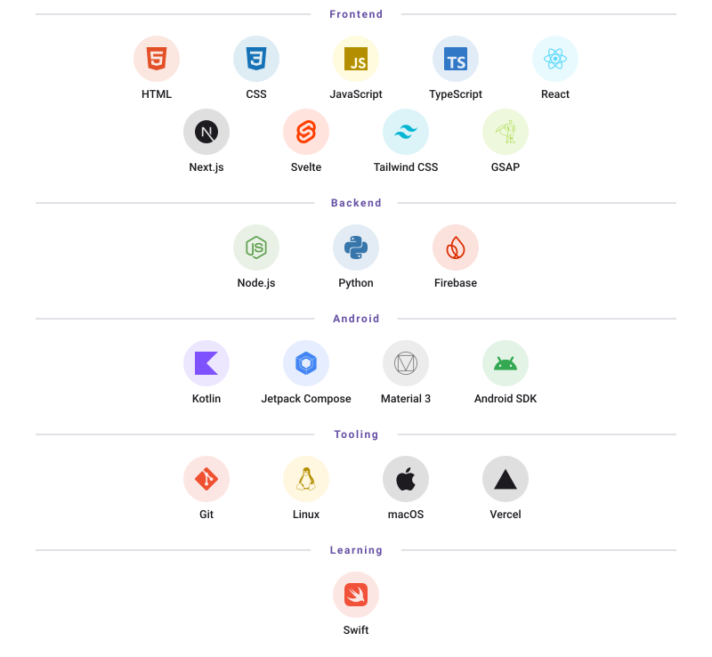

# Bhavesh Patil

Web and Android developer 
Information Technology student, Chhatrapati Sambhajinagar, India

 

## About

I build websites with Svelte and SvelteKit, React, Next.js, TypeScript and Tailwind CSS, 
and Android apps with Kotlin and Jetpack Compose. 
On the backend I work with Node.js and Python, and I'm currently learning Swift.

I care about interfaces that are fast, clear and respectful of privacy. 
Most of what I build works without accounts or tracking.

 

## GitHub

 

 

Starstruck · Pull Shark ×2 · Pair Extraordinaire · YOLO

 

## Web projects

**[Tide](https://tide.iambhvsh.in)** 
A calm, text-first social network built mobile-first, with Svelte.

**[Writing](https://writings.iambhvsh.in)** 
My writing on design, code and craft. Built with SvelteKit, with search, RSS and generated social images.

**[ytdl](https://github.com/iambhvsh/ytdl)** 
A privacy-first YouTube downloader for the command line, built on yt-dlp. 
Everything is processed on your device, and it runs on Windows, macOS, Linux and Termux.

**[Atlas](https://github.com/iambhvsh/atlas)** 
A stateless, privacy-focused search engine API written in Python.

**[Walleee](https://github.com/iambhvsh/walleee)** 
A curated wallpaper app featuring work from artists and designers around the world.

 

## Android apps

**[Shelf](https://github.com/iambhvsh/shelf)** 
A fast, offline-first bookmark manager with link previews, collections, tags, reminders and biometric lock.

**[Theia](https://github.com/iambhvsh/theia)** 
A voice assistant that registers as the Android default assistant, 
with on-device speech transcription and spoken replies.

**[Outflow](https://github.com/iambhvsh/outflow)** 
A minimalist personal finance tracker in Material 3 Expressive. 
Fully offline, with a spending dashboard and no analytics.

 

## Tech stack

 

## Devices

**MacBook Air M5** 
My main machine for writing code, building interfaces and running everything day to day.

**Motorola Edge 50 Fusion** 
My daily phone, and the Android device I carry while building and using my own apps.

**CMF Buds 2 Plus by Nothing** 
My earbuds for music, calls and focus while I work.

 

## Interests

**Aviation** 
A long-standing interest, from how aircraft work to how flight information is presented.

**Music** 
Where my ideas become quieter, clearer and easier to understand.

**Digital aesthetics** 
I pay close attention to typography, spacing and motion, and I like interfaces that feel minimal and intentional.

 

## Support

If you enjoy my projects, you can support what I build with a coffee.

